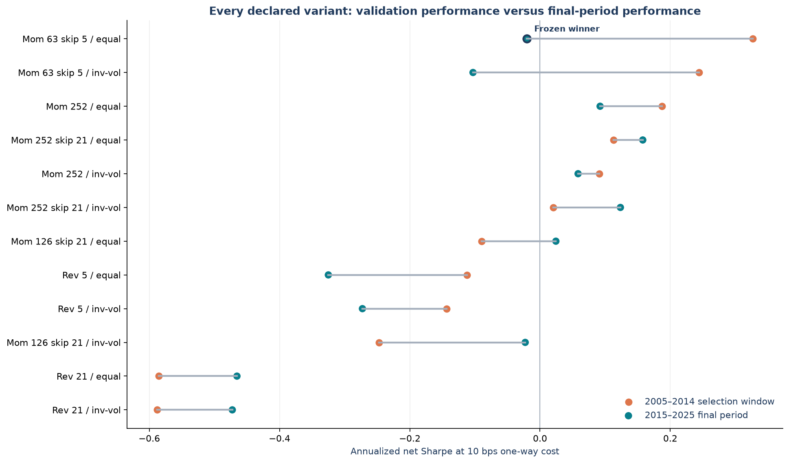
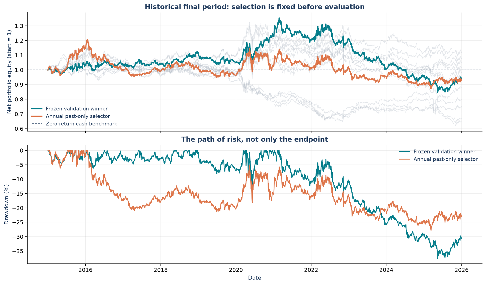
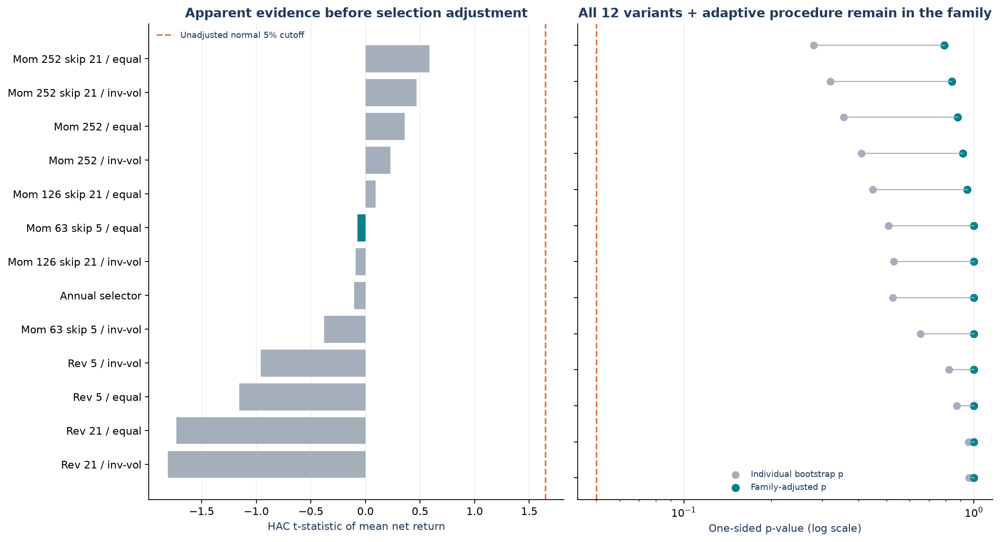
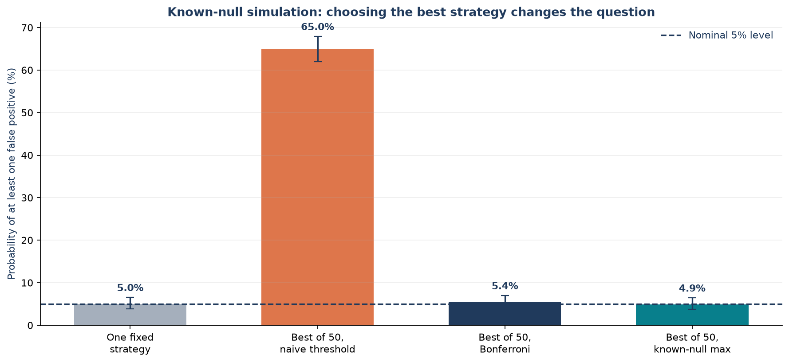

# Can Trading Signals Survive Selection Bias and Transaction Costs?

**Does a promising industry signal survive the way it was selected?**

An original empirical research pipeline for cross-sectional momentum and reversal
in 49 industry portfolios. The project treats chronological selection, execution
timing, transaction-cost accounting and dependence-aware inference as part of the
research question. Every declared candidate remains in the published ledger.

**[Read the executed study](results/published/report.md)** ·
**[Frozen protocol](research_protocol.json)** ·
**[Mathematical methodology](docs/methodology.md)** ·
**[Notebook walkthrough](notebooks/research_walkthrough.ipynb)** ·
**[Audit of the inference itself](results/bootstrap_audit/report.md)**



**Executed finding:** the validation winner's net Sharpe fell from **0.327** to
**−0.020** in the final period at 10 bps one-way costs. The family test did not
reject the no-edge null (**p = 0.792**). In the known-null experiment, naive
best-of-50 selection produced a false positive in **65.0%** of replications,
versus **5.0%** for a prespecified single strategy. The result is a falsification
study with a reproducible audit trail, not a selected profitable backtest.

**Follow-up finding:** a fresh null-size audit exposed a short-sample limitation
in the original inference: at 500 observations its false-positive frequency was
**9.3%** against a nominal 5%, versus **6.0%** with within-bootstrap HAC
studentization. At the actual holdout length the frequencies were **5.3%** and
**5.1%**. The secondary empirical family p-value was **0.786**; the original
**0.792** remains the primary result. [All trials, intervals and scope limits](results/bootstrap_audit/report.md)
are retained.

## The research design

| Stage | Design |
|---|---|
| Data | Kenneth French 49 Industry Portfolios, daily value-weighted returns; complete panel from 1972; fixed cutoff 2025-12-31 |
| Candidate family | Six declared momentum/reversal signals × equal or inverse-volatility tail weighting = 12 candidates |
| Economic exposure | 0.5 long / 0.5 short at monthly rebalancing; target gross 1.0 |
| Execution | Observe month-end close, execute at the next trading close, earn returns afterward |
| Chronology | Development 1972–2004; selection 2005–2014; final period 2015–2025 |
| Primary selection | Highest validation net Sharpe at 10 bps one-way cost, with deterministic tie breaking |
| Secondary procedure | Annual selection on the five preceding years; actual holdings transition and pay costs |
| Inference | HAC mean uncertainty; 2,000 stationary-bootstrap maximum-statistic replicates across all 13 declared procedures |
| Diagnostics | Execution-aligned rank IC, cost frontier, subperiod stability, and a 1,000-repetition known-null selection experiment |

The protocol was recorded before inspecting this implementation's strategy
outcomes. It is historical research, **not external preregistration or a claim
that the 2015–2025 history was previously unknown**. Provider data can be revised.
The historical cutoff does not establish point-in-time vintage availability.

## What makes this a research project

- **A result can fail.** The validation winner is frozen before holdout scoring.
  The best final-period candidate is not silently promoted to the primary strategy.
- **Timing is explicit.** Close-only data cannot support a trade at the same close
  whose return created the signal. A full trading-close delay is modeled and tested.
- **Turnover is a ledger quantity.** Costs use current drifted holdings, include
  opening and final liquidation, and solve for targets on post-cost equity.
- **Selection changes the inference.** Shared stationary blocks preserve observed
  dependence among candidates. The tested family includes losing variants and the
  adaptive selector. A synthetic null experiment makes selection inflation visible.
- **The inference is itself tested.** A separate, frozen follow-up compares the
  actual fixed-scale family test with within-bootstrap HAC studentization and a
  known Gaussian oracle on 2,000 fresh null datasets. All outcomes are retained;
  the primary historical analysis is preserved.
- **The data boundary is honest.** Industry research portfolios are not directly
  investable securities. The repository does not claim real short availability,
  calibrated execution costs, survivorship-free constituent histories, or live alpha.



## Reproduce

Python 3.10 or newer:

```bash
python -m venv .venv
source .venv/bin/activate
python -m pip install -e '.[dev]'
pytest -q

# Full historical design, fewer bootstrap / null replications.
alpha-research --profile quick --output results/quick

# Reproduce the full published experiment.
alpha-research --profile full --output results/reproduced
```

The first run downloads the approximately 4.2 MB provider ZIP. Raw source data are
excluded from Git; the original download fingerprint is recorded in
[`data/source_manifest.json`](data/source_manifest.json). The downloader rejects
a different archive hash by default. If the provider has revised its archive:

```bash
alpha-research --profile full --allow-revised-data --output results/revised-vintage
```

That is a new-vintage replication, not an exact reproduction of the committed
results. Exact reproduction requires the recorded source bytes. All published
reports, figures, candidate return ledgers and allocation schedules are already
included, so a reviewer can inspect the study without a data download.

Without editable installation:

```bash
PYTHONPATH=src python -m alpha_research --profile full --output results/reproduced
```

The quick profile preserves the data window, candidate family, execution and
selection rules. It reduces only bootstrap and null-experiment replications.
No paid data service, API key or broker connection is needed.

## Follow the evidence



| Artifact | What to inspect |
|---|---|
| [`research_ledger.csv`](results/published/research_ledger.csv) | Every candidate across development, validation and final periods |
| [`frozen_selection.json`](results/published/frozen_selection.json) | Winner, selection cutoff, cost assumption and protocol hash |
| [`candidate_daily.csv.gz`](results/published/candidate_daily.csv.gz) | Net/gross returns, NAV, costs, turnover, gross/net exposure and liquidation |
| [`target_weights.csv.gz`](results/published/target_weights.csv.gz) | Actual monthly allocation targets, including zero-target warmup cases |
| [`decision_log.csv.gz`](results/published/decision_log.csv.gz) | Decision and execution dates; eligible industry count |
| [`family_inference.csv`](results/published/family_inference.csv) | Individual and family-adjusted evidence across all 13 procedures |
| [`annual_selection_scores.csv`](results/published/annual_selection_scores.csv) | Every annual selector's historical candidate ranking |
| [`cost_sensitivity.csv`](results/published/cost_sensitivity.csv) | All candidates at 0, 5, 10, 25 and 50 bps one-way costs |
| [`manifest.json`](results/published/manifest.json) | Source and protocol fingerprints, versions, runtime and artifact hashes |

## A compact model specification

At each month-end close, the signal is a signed sum of lagged log returns. A
252-day lookback with 21 skipped days uses **231 returns ending 21 days ago**.
The top and bottom floor(20% × eligible industries) form equally sized long and
short groups. Inverse-volatility weighting uses only the prior 63 daily observations
and normalizes each leg separately to 0.5 gross exposure.

At the next trading close, current holdings have drifted. With a one-way cost
rate $\tau$, target weights $w^*$ on post-cost equity, and pre-trade weights $w^-$,
the fraction of equity paid in costs satisfies

$$c=\tau\sum_i\left|w_i^*(1-c)-w_i^-\right|.$$

The backtester solves that scalar equation. It records the full absolute traded
notional; turnover is not divided by two. The cost assumption is a scenario and
omits impact, borrow fees, locate constraints, financing and underlying portfolio
reconstitution costs.

The final-period family test centers each return series, jointly resamples dates
in stationary blocks and compares the largest observed positive HAC-scaled mean
with the distribution of the largest null statistic. It is explicitly a
**single-step fixed-scale maximum test**, not a repackaged claim to implement
Hansen SPA, the Deflated Sharpe Ratio or PBO/CSCV.

## Why a null experiment belongs in the portfolio



All simulated candidate strategies in this experiment have zero true mean, yet
selecting the maximum changes the chance of an apparently significant result.
The report compares a prespecified strategy, naive best-of-50 selection,
Bonferroni, and a separately calibrated known-null maximum cutoff. It includes
finite-sample uncertainty and does not claim any adjustment works perfectly.

That illustration does not validate the empirical bootstrap. A separate
[null-size audit](results/bootstrap_audit/report.md) runs the actual procedure on
1,000 fresh datasets at each of two sample lengths, paired with a predeclared
studentized alternative and an exact Gaussian covariance oracle. It also reports
both empirical family p-values as a mandatory secondary comparison. No result is
used to replace the original procedure or select a favorable bandwidth.

```bash
python -m alpha_research.bootstrap_audit
python scripts/render_bootstrap_audit.py
```

## Repository map

```text
research_protocol.json       immutable choices for the published run
src/alpha_research/
  data.py                    provider download, panel parser and vintage fingerprint
  signals.py                 lagged scores and deterministic portfolio construction
  backtest.py                close-only execution and self-financing cost ledger
  selection.py               chronological selection and execution-aligned rank IC
  inference.py               HAC and stationary-bootstrap family maximum test
  null_experiment.py         known-null selection-inflation experiment
  bootstrap_audit.py          separate fresh-seed size and studentization audit
  experiments.py             complete study ledger and artifact generation
tests/                       numerical, timing, accounting and selection invariants
docs/                        derivation, limits, provenance and interview guide
results/published/           executed report, figures and retained research outputs
results/bootstrap_audit/     independent null-size audit and empirical comparison
```

## Interpretation and provenance

The project studies whether declared **predictors and research procedures** are
credible under a specified historical experiment. Dollar neutrality at rebalancing
does not imply market-beta neutrality. A positive long-short return is not a
demonstration of risk-adjusted alpha or an implementable investment opportunity.

The data are provided by the [Kenneth French Data Library](https://mba.tuck.dartmouth.edu/pages/faculty/ken.french/data_library.html).
The research design is informed by established work on
[backtest overfitting](https://www.davidhbailey.com/dhbpapers/backtest-prob.pdf),
[data snooping](https://www.ssc.wisc.edu/~bhansen/718/White2000.pdf), and
[HAC inference](https://www.nber.org/papers/t0055).
The implementation, accounting derivation, experiment pipeline and generated
figures are original. See [references](docs/references.md),
[limitations](docs/limitations.md), [data rights](data/README.md), and the
[research discussion guide](docs/interview_guide.md).

