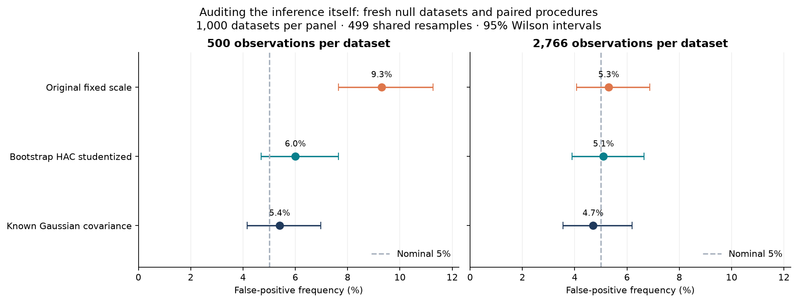

# Does the family test control false positives in a known null?

This is a **separate follow-up study**, motivated by a computational
calibration check. It does not replace the frozen historical analysis or choose a preferred method
after inspecting its outcome. Its [protocol](../../bootstrap_audit_protocol.json)
was fixed before evaluating this fresh seed bank; all three procedures are retained.

## Executed design

- **1,000 independent outer datasets per sample-size cell**, with six zero-mean,
  equicorrelated Gaussian AR(1) series: time coefficient 0.2, cross-candidate
  correlation 0.35, and 200 burn-in observations.
- Sample sizes **500 and 2,766**; the latter matches the empirical holdout length.
  Six candidates isolate this audit and do not reproduce the thirteen empirical
  strategies or their return distribution.
- **499 stationary-bootstrap replicates**, mean block length 21 and Bartlett HAC
  bandwidth 21. The original and studentized tests use identical datasets and
  identical date indices. Each global p-value uses the same plus-one rule.
- The oracle uses the exact Gaussian covariance, finite-sample AR mean variance
  and a maximum cutoff computed by one-dimensional quadrature: **2.337617783033**.
  It checks outer Monte Carlo variability; it is unavailable for market returns.

The primary historical inference retains **2,000** replicates. The audit's 499
replicates trade inner Monte Carlo precision for 1,000 genuinely separate outer
datasets; the audit estimates the behavior of this specific finite-replicate test.
Sample-size cells reuse trial addresses and must not be pooled as independent data.

## Results

With 500 observations, the original fixed-scale test rejected a true null in
**9.3%** of datasets, compared with
**6.0%** for studentization. At the actual holdout
length of 2,766 observations, the corresponding frequencies were
**5.3%** and **5.1%**.
The shorter-sample result identifies a material limitation of the original
approximation in this design; the longer-sample intervals below include the
nominal 5% level for both procedures. This motivates reporting finite-sample
calibration rather than asserting that an adjusted p-value automatically has
correct size.



| Observations | Procedure | Rejections | Rejection frequency | 95% Wilson interval |
|---|---|---|---|---|
| 500 | Original fixed scale | 93/1000 | 9.30% | [7.65%, 11.26%] |
| 500 | Bootstrap HAC studentized | 60/1000 | 6.00% | [4.69%, 7.65%] |
| 500 | Known Gaussian covariance | 54/1000 | 5.40% | [4.16%, 6.98%] |
| 2,766 | Original fixed scale | 53/1000 | 5.30% | [4.07%, 6.87%] |
| 2,766 | Bootstrap HAC studentized | 51/1000 | 5.10% | [3.90%, 6.64%] |
| 2,766 | Known Gaussian covariance | 47/1000 | 4.70% | [3.55%, 6.19%] |

The nominal rejection probability is 5%. These are Monte Carlo estimates for the
declared Gaussian process, with uncertainty shown. They do not establish exact
size control over other dependence structures, heavy tails, regime changes,
candidate families or bandwidth choices.

| Observations | Studentized minus fixed | Paired approximate 95% interval | Fixed-only / student-only rejections |
|---|---|---|---|
| 500 | -3.30 pp | [-4.44, -2.16] pp | 34 / 1 |
| 2,766 | -0.20 pp | [-0.59, +0.19] pp | 3 / 1 |

The difference uses paired rejection indicators on the same outer datasets.
Negative values mean fewer false positives for studentization in this experiment;
that does not prove uniform superiority or justify selecting the most favorable
empirical p-value.

## What changes mathematically

Both methods compare the largest positive observed HAC-scaled mean with a
centered bootstrap maximum. The original method holds the original HAC scale
fixed within each resample. The alternative recomputes Bartlett HAC uncertainty
inside each bootstrap sample. Its numerator retains the sample mean of resampled,
originally centered returns; only its variance calculation centers that sample
again. Shared date indices preserve cross-candidate dependence.

The vectorized HAC calculation was checked against independent scalar calls;
studentized p-values were checked against a scalar-loop implementation and across
batch partitions. The fixed-scale branch calls the actual original research
function, rather than a separate approximation to it.

## Mandatory empirical comparison

Before seeing fresh null-size outcomes, a [separate protocol](../../bootstrap_empirical_followup_protocol.json)
required reporting both procedures on all thirteen original empirical holdout
series, using 2,000 shared replicates, block/HAC bandwidth 21 and the original
seed. The daily ledger retains 12 significant digits; the reconstructed original
fixed-scale p-value matches the published value exactly.

- Original primary fixed-scale family p: **0.792104**.
- Separately labeled studentized family p: **0.786107**.

Both are reported regardless of their order. Neither replaces the other. A null
rejection frequency in the Gaussian audit is not a post-hoc correction factor for
these empirical p-values. The original validation winner and historical ledger
remain unchanged.

## Why this is separate from the best-of-50 illustration

The primary report's best-of-50 experiment compares naive selection, Bonferroni
and a known-null calibrated cutoff. That demonstrates selection inflation; it
does **not** validate the empirical stationary-bootstrap procedure. This follow-up
actually runs that procedure on new null datasets and compares a predeclared
studentized alternative.

An exploratory 200-dataset reviewer check motivated the follow-up. Its oracle
also rejected more often than expected, which is why this report uses a separate
1,000-dataset seed bank rather than treating the exploratory frequencies as a
universal calibration failure. The fresh protocol, all trial p-values and both
method outcomes are retained; no bandwidth was selected from these results.

## Reproduce and inspect

```bash
python -m alpha_research.bootstrap_audit
python scripts/render_bootstrap_audit.py
```

The audit took 16.5 minutes on the recorded host;
runtime varies. [trials.csv](trials.csv) retains every dataset seed, bootstrap seed,
p-value and rejection indicator. [summary.csv](summary.csv),
[paired_differences.csv](paired_differences.csv),
[empirical_comparison.json](empirical_comparison.json) and [manifest.json](manifest.json)
provide counts, uncertainty, input fingerprints and source hashes.
