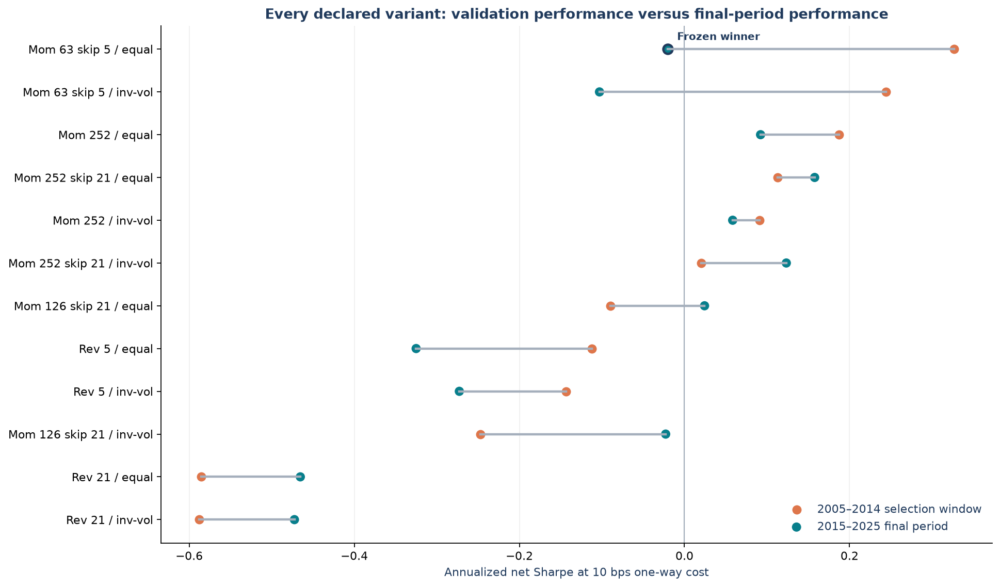
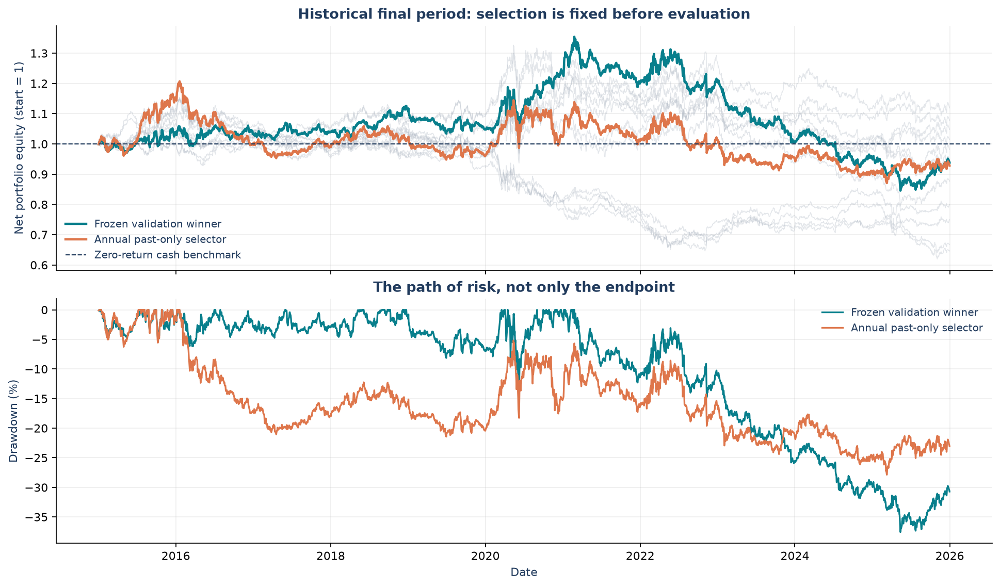
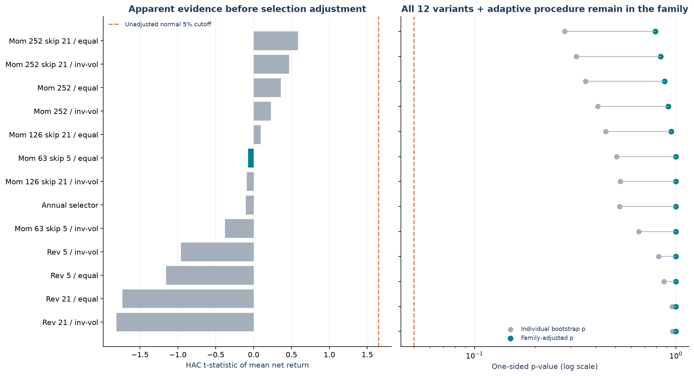
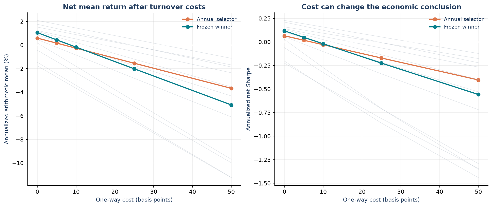
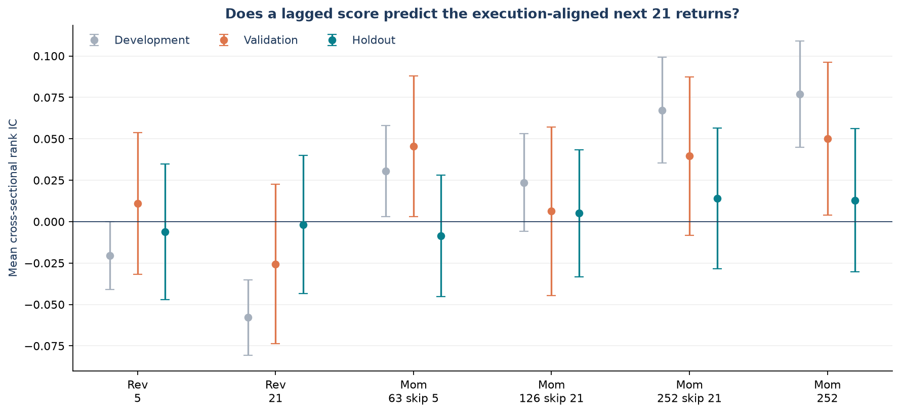
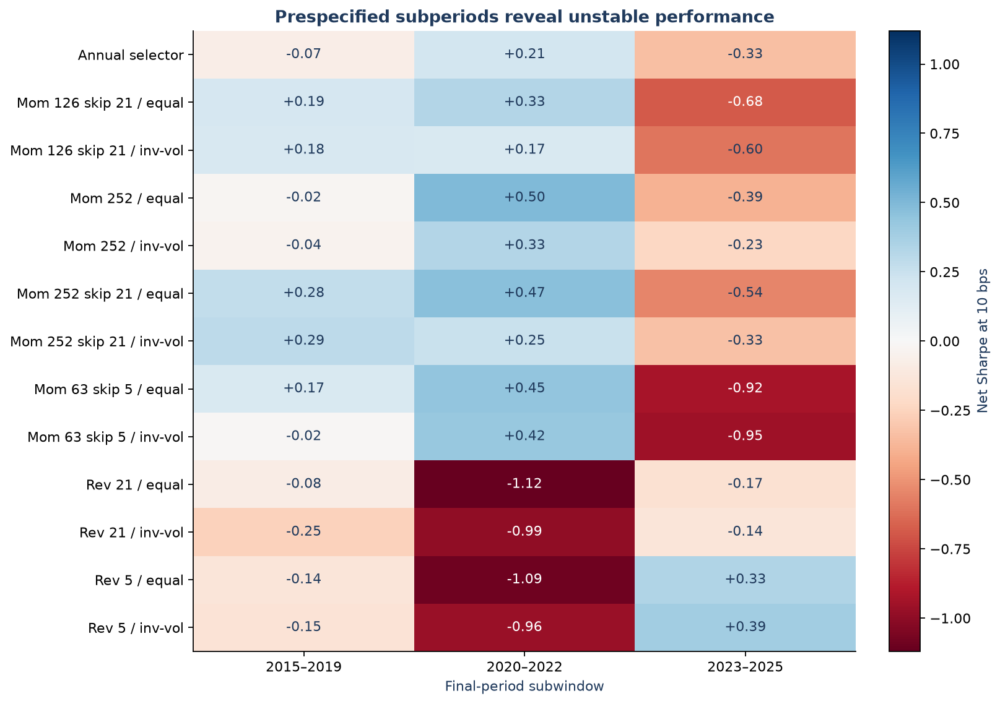
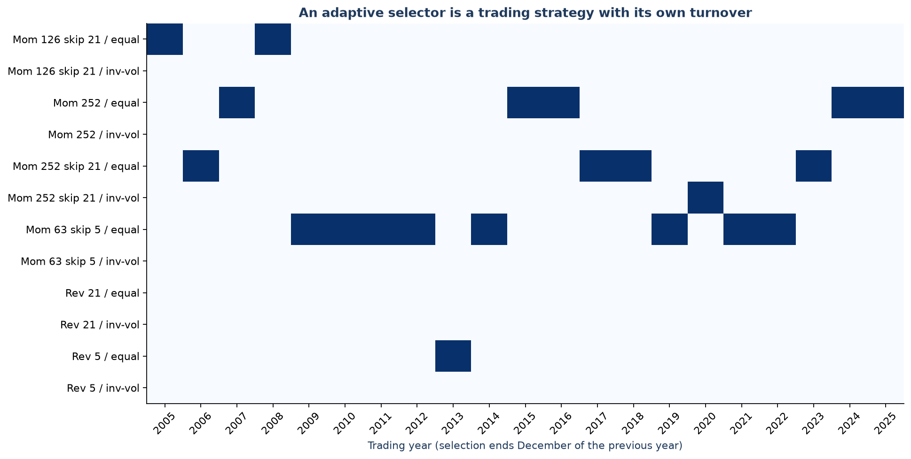
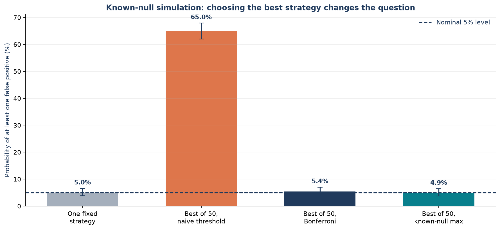

# Which industry signals survive selection and costs?

This report is generated from the frozen protocol and retained research ledger.
It studies historical **research portfolio returns**, not directly tradable securities.
Positive long-short returns are not automatically risk-adjusted alpha.

## The declared selection and its final-period outcome

The validation rule selected **`momentum_63_skip5__equal`** using only 2005–2014 net Sharpe at
10 basis points of one-way traded-notional cost. Its validation Sharpe was
**0.327**. No final-period result was used to choose that candidate.

Over 2015–2025, its net annualized arithmetic mean was **-0.18%**,
net Sharpe **-0.020**, CAGR **-0.58%**, maximum drawdown
**-37.56%**, and annual traded-notional turnover
**12.27 times equity**. These metrics use a 1.0 gross target
(0.5 long and 0.5 short), zero cash/short financing, delayed close execution, and
explicit entry and terminal-liquidation costs.

The selected mean daily return's stationary-block 95% percentile interval,
annualized arithmetically, is **[-4.79%, 4.26%]**.
It describes temporal sampling uncertainty under the bootstrap approximation;
it does not include historical data revisions, financing, model uncertainty,
unobserved trading costs or every research choice outside the declared family.

## All candidates remain visible

The six signals crossed with two weighting rules produce 12 fixed candidates.
A separately declared annual selector chooses from that family using only its
five preceding calendar years. Its actual holdings are rebalanced and costs paid
when the choice changes; no return series are spliced without transition trades.

| candidate | annual_mean | sharpe | max_drawdown | annual_turnover |
| --- | --- | --- | --- | --- |
| reversal_5__equal | -2.36% | -0.325 | -38.07% | 19.14× |
| reversal_5__inverse_volatility | -1.81% | -0.273 | -34.16% | 19.79× |
| reversal_21__equal | -3.67% | -0.465 | -44.05% | 19.02× |
| reversal_21__inverse_volatility | -3.42% | -0.472 | -41.02% | 19.60× |
| momentum_63_skip5__equal | -0.18% | -0.020 | -37.56% | 12.27× |
| momentum_63_skip5__inverse_volatility | -0.85% | -0.103 | -36.26% | 13.14× |
| momentum_126_skip21__equal | 0.21% | 0.024 | -28.46% | 9.42× |
| momentum_126_skip21__inverse_volatility | -0.18% | -0.023 | -26.86% | 10.36× |
| momentum_252_skip21__equal | 1.44% | 0.158 | -17.64% | 6.43× |
| momentum_252_skip21__inverse_volatility | 1.03% | 0.123 | -18.69% | 7.25× |
| momentum_252__equal | 0.88% | 0.092 | -21.68% | 6.41× |
| momentum_252__inverse_volatility | 0.51% | 0.058 | -17.35% | 7.17× |
| adaptive_selector | -0.27% | -0.030 | -27.86% | 8.52× |

The fixed validation winner is the primary selection result. The best strategy
found by sorting final-period outcomes is **not** promoted to a replacement winner.
All development, validation and final-period metrics are in `research_ledger.csv`,
and every candidate's daily accounting is in `candidate_daily.csv.gz`.

## Did the best-looking result survive the declared family?

We test the one-sided null that every one of the **13** declared procedures
(12 fixed candidates plus the annual adaptive selector) has nonpositive expected
net return. The benchmark is zero return under the stated financing convention.
This is not a factor-alpha test.

The test jointly resamples centered candidate return vectors using stationary
blocks with mean length 21 trading days. All columns use the same resampled dates,
preserving observed cross-candidate dependence. The maximum positive HAC-scaled
mean is the family statistic. Original HAC scales are held fixed in the bootstrap;
this is a single-step fixed-scale max test, not a claim to implement Hansen SPA,
the Deflated Sharpe Ratio or combinatorial symmetric cross-validation.

This is approximate inference. The separate [fresh-seed null-size audit](../bootstrap_audit/report.md)
tests the actual procedure against a predeclared within-bootstrap HAC-studentized
alternative and an exact Gaussian covariance oracle. It preserves this original
analysis and reports both empirical family p-values as a secondary comparison.
The best-of-50 known-null illustration below is a different experiment and does
not validate this bootstrap's finite-sample size.

With **2000** replicates, the global family p-value is
**0.7921**. The frozen winner's individual bootstrap
p-value is **0.5082**, and its family-adjusted value is
**1.0000**. The initial winner was selected outside the
final period; showing the family correction also makes the later inspection of
every final-period candidate visible.

| candidate | hac_t | individual_bootstrap_p | family_adjusted_p |
| --- | --- | --- | --- |
| adaptive_selector | -0.105 | 0.5247 | 1.0000 |
| momentum_126_skip21__equal | 0.094 | 0.4478 | 0.9465 |
| momentum_126_skip21__inverse_volatility | -0.089 | 0.5302 | 1.0000 |
| momentum_252__equal | 0.357 | 0.3558 | 0.8776 |
| momentum_252__inverse_volatility | 0.228 | 0.4093 | 0.9165 |
| momentum_252_skip21__equal | 0.586 | 0.2799 | 0.7921 |
| momentum_252_skip21__inverse_volatility | 0.467 | 0.3203 | 0.8396 |
| momentum_63_skip5__equal | -0.074 | 0.5082 | 1.0000 |
| momentum_63_skip5__inverse_volatility | -0.381 | 0.6552 | 1.0000 |
| reversal_21__equal | -1.733 | 0.9600 | 1.0000 |
| reversal_21__inverse_volatility | -1.810 | 0.9630 | 1.0000 |
| reversal_5__equal | -1.155 | 0.8711 | 1.0000 |
| reversal_5__inverse_volatility | -0.960 | 0.8196 | 1.0000 |

The least-favorable recentering sets every candidate mean to zero and may be
conservative when many candidates have negative true means. Stationarity/mixing
and sufficiently stable HAC estimation remain approximations. We retain block
lengths 5, 21 and 63 in `bootstrap_block_sensitivity.csv`; a favorable block length
is not selected after the fact. Selection errors outside this documented family
are not magically corrected by the bootstrap.

## What transaction costs change

Every trade uses current drifted holdings. With target weights defined on post-cost
equity, cost is solved from

$$c_t=\tau\sum_i|w^*_{i,t}(1-c_t)-w^-_{i,t}|.$$

Turnover is the full one-way absolute traded notional, without dividing by two.
The 10 bps default is a scenario, not an empirically calibrated execution estimate.
The provider's industry portfolios cannot themselves be purchased at this cost.

For the frozen winner:

| cost_bps | annual_mean | sharpe | max_drawdown |
| --- | --- | --- | --- |
| 0.0 | 1.05% | 0.117 | -34.10% |
| 5.0 | 0.43% | 0.049 | -35.85% |
| 10.0 | -0.18% | -0.020 | -37.56% |
| 25.0 | -2.02% | -0.225 | -42.41% |
| 50.0 | -5.08% | -0.558 | -50.30% |

`break_even_cost.csv` additionally reports a **first-order approximate** threshold
equal to zero-cost annual mean divided by zero-cost annual turnover, converted to
basis points. It is an arithmetic-mean approximation, not an exact CAGR root or a
market impact/capacity estimate. Exact tested cost scenarios are retained above.

## Signal diagnostics and temporal stability

Rank IC relates each month-end score to industry returns earned only after the
next trading close, over the subsequent 21 trading days. A complete forward label
must fit inside the reported period. Scores use past returns; forward returns
are diagnostic labels and never enter a trading decision. Monthly IC intervals
use three HAC lags and are exploratory, not a second family of confirmed alpha tests.

The final period is partitioned into prespecified 2015–2019, 2020–2022 and 2023–2025
windows. Their returns are slices of the actual continuous strategy path, rather
than new backtests that reset holdings for favorable subperiods.

## A known-null experiment: why choosing the maximum is different

All 50 simulated candidate strategies have exactly zero expected return. They share
cross-candidate correlation 0.35 and AR(1) coefficient 0.2; each series has 756
observations after burn-in. We repeat the selection exercise
**1000** times. A separate independent calibration stream
supplies the known-null maximum cutoff. The resulting Wilson 95% intervals describe
Monte Carlo uncertainty in the probability of at least one false rejection.

| method | false_positive_rate | lower | upper |
| --- | --- | --- | --- |
| prespecified_single_reject | 5.0% | 3.8% | 6.5% |
| naive_reject | 65.0% | 62.0% | 67.9% |
| bonferroni_reject | 5.4% | 4.2% | 7.0% |
| known_null_max_reject | 4.9% | 3.7% | 6.4% |

The known-null maximum adjustment is illustrative simulation calibration, not the
empirical block bootstrap and not a method available when the true data-generating
process is unknown. Bonferroni here uses asymptotic HAC normal p-values; finite-sample
HAC error can affect its realized level. This experiment exposes selection inflation
without presenting the adjusted procedure as infallible.

## Data provenance and reproducibility

- Source: Kenneth French's 49 Industry Portfolios, daily **value-weighted** panel.
- Complete research period: 1972-01-03 through 2025-12-31;
  13614 daily observations and 49 industries.
- Original archive SHA-256: `b9d36d571e968d71f7b03207e7fed6398554f953719b8c1bf3ee3ad8d00e7520`.
- Protocol SHA-256: `76e3ce91e6d50ceefd53ab05a48128539217441e8776153ea378b3f2e84d51a8`.
- The raw provider archive is excluded from the Git repository. The downloader
  verifies its recorded hash; a changed vintage requires an explicit override.
- A 1971 missing software-industry observation motivated the documented move of the
  development start to 1972 before strategy outcomes were inspected.
- Current-vintage historical data can contain revisions. A date cutoff is not a
  guarantee of point-in-time historical availability or absence of survivorship effects.

The research portfolios are aggregated, annually reconstituted classifications.
They are not ticker-level holdings or a directly implementable shortable universe.
Dollar neutrality at rebalancing is not beta neutrality, and holdings drift between
rebalances. The equal-weight industry context series is long-only and is not used
as a risk-matched alpha benchmark. See [methodology](../../docs/methodology.md),
[limitations](../../docs/limitations.md), [data rights](../../data/README.md), and
[references](../../docs/references.md) before interpreting the economic result.
